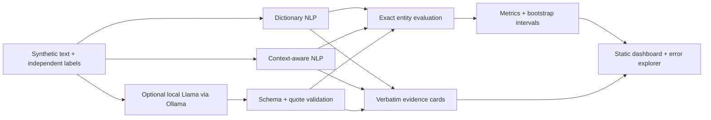

# Clinical Document Intelligence

**A reproducible clinical NLP evaluation lab: extract structured mentions, preserve assertion context, and trace every summary sentence to its source.**

Built as a healthcare data science portfolio project. The public demo uses **166 hand-authored synthetic notes**, not patient records. It compares dictionary NLP, context-aware NLP, and an optional local Llama 3.1 extraction system. The dashboard makes false positives and missed mentions inspectable rather than hiding them behind one score.

> Research demonstration. No diagnosis, treatment recommendation, clinical validation, HIPAA certification, or FDA clearance is claimed.

## Run in two minutes

Python 3.11+; the baseline, statistical evaluation, tests, and dashboard require **no third-party Python packages**.

```bash
git clone https://github.com/RichaShiny/clinical-document-intelligence.git
cd clinical-document-intelligence
python -m unittest discover -s tests -v
python -m clinical_intelligence.pipeline
python -m http.server 8765 --bind 127.0.0.1 --directory dashboard
```

Open **http://127.0.0.1:8765**. You can also open `dashboard/index.html` directly: the dataset is bundled in `results.js`. There is no upload form or external inference service in the dashboard.

The baseline command regenerates and replaces the current dashboard and metrics with baseline-only results. Preserve committed LLM results before rerunning if you want to compare them later.

## What the project demonstrates

| Skill | Implementation |
|---|---|
| Unstructured data processing | Character offsets, aliases, canonical concepts, assertion categories |
| Clinical NLP | Conditions, medications, procedures, follow-up instructions |
| Generative AI integration | Local Ollama structured-output extraction with post-validation |
| Statistical analysis | Exact-match precision/recall/F1, seeded note bootstrap, paired system differences |
| Exploration and communication | Interactive performance bars, age slices, source highlighting, error explorer, JSON export |
| Responsible development | Data card, model card, risk register, intended-use limits, provenance and CI |

There is **no supervised classifier or fine-tuning** in this version. The LLM is pretrained; dictionaries and context rules are manually authored. Summaries are **extractive source sentences**, including when the LLM supplies the entities. An abstractive LLM summarizer is not implemented or scored.

## Architecture



## Run a real local LLM comparison

Install [Ollama](https://ollama.com/) and run a model locally. Review the model's license and hardware needs before downloading it.

```bash
ollama pull llama3.1
python -m clinical_intelligence.pipeline --ollama-model llama3.1:latest
```

The adapter uses the [documented structured-output API](https://docs.ollama.com/capabilities/structured-outputs) at `127.0.0.1:11434`. It evaluates a **fixed, seed-42 sample of 15 test notes plus all 16 challenge notes**, selected before inspecting predictions. Both baselines run on all 166 notes. `llm_comparison.baseline_on_same_subset` provides matched baseline results: do not compare differently sized test cohorts without this field.

Temperature and sampling seed are fixed; identical output is not guaranteed across hardware or Ollama/model versions. No paid API is used. Local compute costs are unmeasured. Failed requests stop the run; the code does not silently substitute rules or invent LLM results. Only synthetic text is sent to the local endpoint.

## Baseline findings

| System | Template test (75 notes) | Challenge set (16 notes) |
|---|---:|---:|
| Dictionary | 0.550 micro F1 | 0.333 micro F1 |
| Context-aware rules | 1.000 micro F1 | 0.762 micro F1 |

The perfect template score reflects a narrow, controlled vocabulary and simple templates. The challenge set exposes post-mention negation, uncertainty, history, and family-experiencer failures. These are engineering regression checks, **not evidence of clinical performance**. All exact scores, counts, bootstrap intervals, latency, LLM coverage, and matched-subset comparisons are in [`reports/metrics.json`](reports/metrics.json).

## Measured LLM experiment

Llama 3.1 8B Q4_K_M was executed locally on the fixed 31-note subset. Initially, it often supplied sentence-level quotes while the validator required mention-only quotes. Strict-v1 validation produced F1 **0.0328 on 15 test notes** and **0.1667 on 16 challenge notes**. This was primarily a span-alignment integration failure, not a measured rate of medical hallucination.

A deterministic normalizer now aligns a known canonical alias within an exact unique source quote and derives follow-up text directly from its quoted instruction. Replaying the **same saved outputs**, without additional model calls, yielded F1 **0.9244 (15 test notes)** and **0.8095 (16 challenge notes)**. The contextual baseline on those exact subsets scored **1.0000** and **0.7619**, respectively. These are **exploratory post-hoc results**; the adapter was improved after inspecting the outputs, so a new independent holdout is needed.

The raw field values, original strict metrics, environment and model digest are retained in `reports/llm_raw.json` and `reports/llm_environment.json`. To restore/reproduce the committed replay after running the baseline command:

```bash
python -m clinical_intelligence.replay
```

The replay reuses original inference latency and explicitly excludes offline normalization time. A fresh `--ollama-model` run uses the updated normalizer and measures its full request/validation path. See [the experiment note](docs/LLM_EXPERIMENT.md).

## Explore the dashboard

Select a system and split; inspect entity-level precision, recall, and F1. Filter to documents with errors, search for a concept, and inspect highlighted evidence, assertion labels, offsets, and unmatched gold/predicted entities. Download metrics as JSON. Synthetic age groups are included to demonstrate slice analysis, not real demographic fairness.

## Repository map

```text
clinical_intelligence/    corpus generation, NLP, LLM adapter, evaluation, CLI
 data/                   synthetic JSONL and SHA-256 manifest
 dashboard/              responsive static UI and generated results
 reports/                measured metrics and run evidence
 docs/                   methodology, data/model cards, responsible AI, interview guide
 tests/                  unit, protocol, and end-to-end regression tests
 .github/workflows/      Python 3.11/3.13 CI
```

## Further development

Move to an appropriately licensed, independently annotated corpus; freeze patient-level splits; compare a trained assertion classifier or clinical transformer against rules and the LLM; obtain clinician adjudication; measure semantic summarization correctness and omissions. The current corpus is too small and repetitive to justify training a clinical model or claiming generalization.

See [data provenance and external dataset options](docs/DATA_CARD.md), [methodology](docs/METHODOLOGY.md), [model card](docs/MODEL_CARD.md), [responsible AI](docs/RESPONSIBLE_AI.md), and [interview walkthrough](docs/INTERVIEW_GUIDE.md).

## License

Project code and the project's original synthetic fixtures: MIT, as stated in [LICENSE](LICENSE). Third-party model and dataset licenses remain separate. No external clinical dataset is redistributed.
